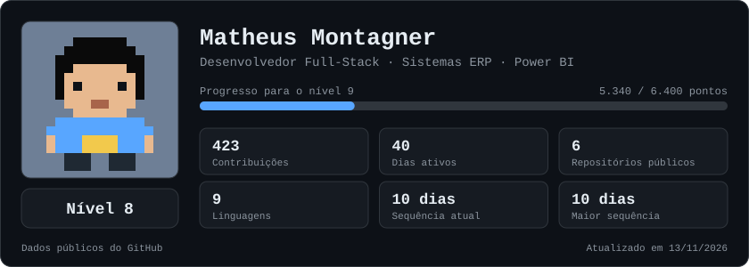
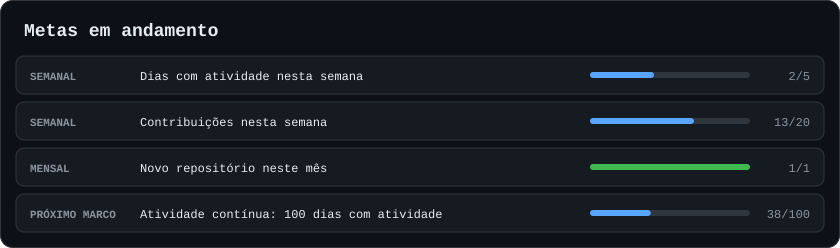
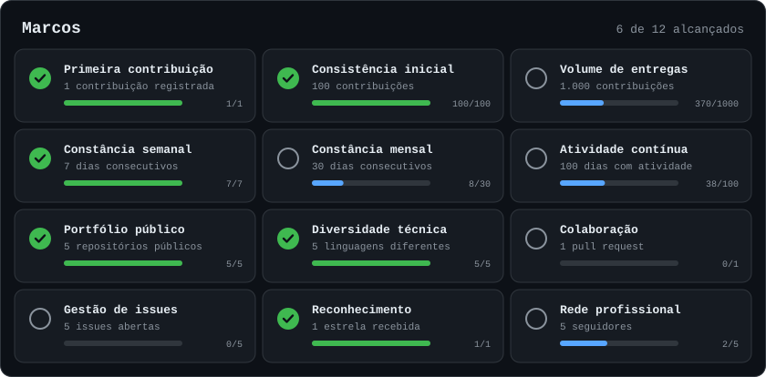

## Metas em andamento

## Marcos

## Projetos

<!-- PROJETOS:START -->
| Projeto | Descrição | Linguagem | Última atualização |
|---|---|---|---|
| [colorbitz](https://github.com/matheusmontagner8/colorbitz) | Colorbitz: puzzle neon para Android feito em Godot 4 + GDScript. Toque em grupos de blocos da mesma cor. | GDScript | 13/11/2026 |
| [Modelagem-de-Dados](https://github.com/matheusmontagner8/Modelagem-de-Dados) | Modelagem de Banco de Dados - Modelo Conceitual (DER) e Dicionário de Dados | HTML | 10/11/2026 |
| [portfolio-matheus-montagner](https://github.com/matheusmontagner8/portfolio-matheus-montagner) | Portfólio de projetos | Python | 16/09/2026 |
| [achadinhos-linktree](https://github.com/matheusmontagner8/achadinhos-linktree) | Página de links (estilo Linktree) do Achadinhos Mais | HTML | 15/09/2026 |
| [triage-trio-plus](https://github.com/matheusmontagner8/triage-trio-plus) | Projeto de Engenharia de Prompt e IA | TypeScript | 10/09/2026 |
<!-- PROJETOS:END -->

<b>Como a pontuação é calculada</b>

 

Os dados vêm da API do GitHub e o painel é atualizado todos os dias por uma GitHub Action.

| Item | Pontos |
|---|---|
| Contribuição | 10 |
| Pull request | +40 |
| Issue | +20 |
| Repositório público | 100 |
| Estrela recebida | 50 |
| Seguidor | 30 |
| Cada dia da maior sequência | 20 |

O nível N começa em `100 × (N − 1)²` pontos.

