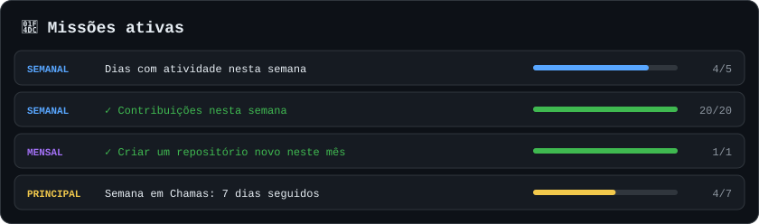
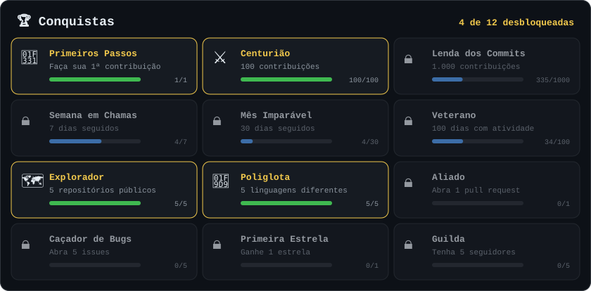

**Desenvolvedor de Sistemas ERP · Full-Stack · Front-end · Back-end · Power BI**

## 📜 Quadro de missões

## 🏆 Sala de troféus

## 🗺️ Dungeons exploradas

<!-- DUNGEONS:START -->
| Dungeon | Missão | Linguagem | Última exploração |
|---|---|---|---|
| [Modelagem-de-Dados](https://github.com/matheusmontagner8/Modelagem-de-Dados) | Modelagem de Banco de Dados - Modelo Conceitual (DER) e Dicionário de Dados | HTML | 05/11/2026 |
| [portfolio-matheus-montagner](https://github.com/matheusmontagner8/portfolio-matheus-montagner) | Portfólio de projetos | Python | 16/09/2026 |
| [achadinhos-linktree](https://github.com/matheusmontagner8/achadinhos-linktree) | Página de links (estilo Linktree) do Achadinhos Mais | HTML | 15/09/2026 |
| [triage-trio-plus](https://github.com/matheusmontagner8/triage-trio-plus) | Projeto de Engenharia de Prompt e IA | TypeScript | 10/09/2026 |
<!-- DUNGEONS:END -->

## 🐍 Arena de contribuições

<picture>
  <source media="(prefers-color-scheme: dark)" srcset="dist/snake-dark.svg">
  <source media="(prefers-color-scheme: light)" srcset="dist/snake-light.svg">
  
</picture>

<b>⚙️ Como funciona o sistema de XP</b>

 

Os dados vêm da API do GitHub e a ficha é atualizada todo dia por uma GitHub Action.

| Ação | XP |
|---|---|
| Contribuição | 10 |
| Pull request | +40 |
| Issue | +20 |
| Repositório público | 100 |
| Estrela recebida | 50 |
| Seguidor | 30 |
| Cada dia da maior sequência | 20 |

Cada nível exige mais XP que o anterior: o nível N começa em `100 × (N − 1)²` XP.

